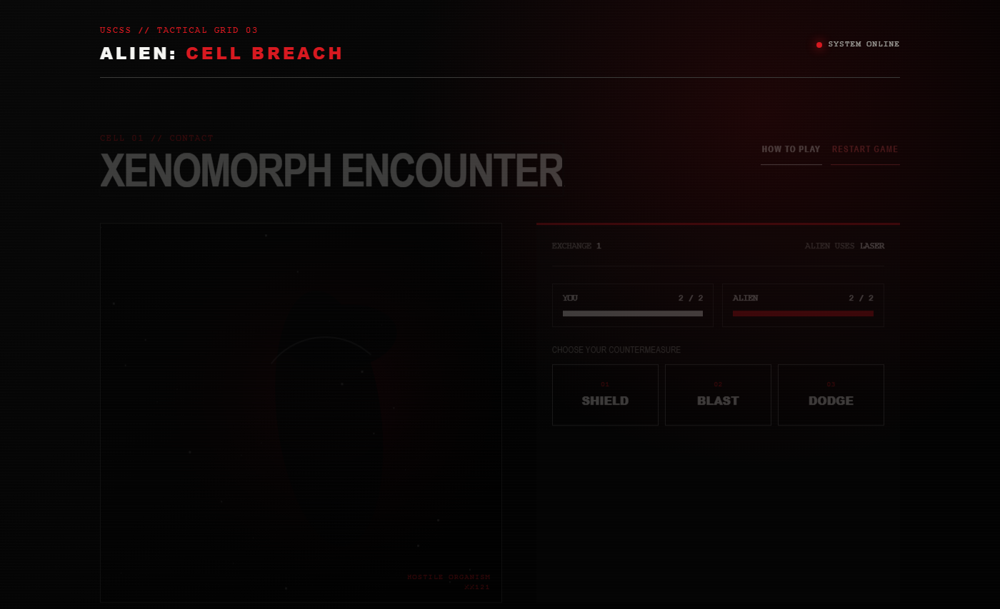

# Alien: Cell Breach

An unofficial, noncommercial classroom fan project inspired by the *Alien* franchise. Every tic-tac-toe cell triggers a short Xenomorph encounter: win the battle to place X, or lose it and the alien places O.



## Play locally

From this folder, run:

```powershell
python -m http.server 8765 --bind 127.0.0.1
```

Then open <http://127.0.0.1:8765/>.

## Battle counters

| Alien attack | Your counter |
|---|---|
| Laser | Shield |
| Shield | Blast |
| Claw | Dodge |

Win a battle to place X. Lose to place O. Complete three X cells in a line before the alien completes three O cells.

## Test

```powershell
node --test tests/*.test.js
node tests/browser-smoke.mjs http://127.0.0.1:8765/
```

The browser smoke test requires the local server and Microsoft Edge on Windows.

See [game-rules.md](game-rules.md) for complete rules and [game-test-report.md](game-test-report.md) for verification evidence.
